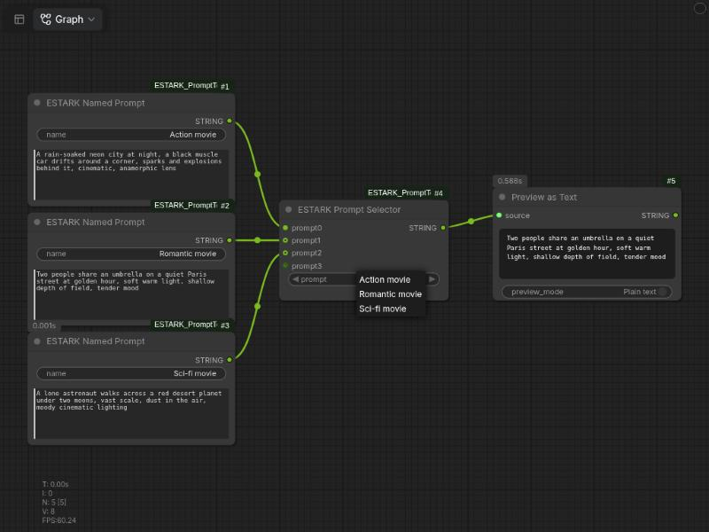

# ESTARK Prompt Tools

Keep several prompts in one ComfyUI workflow and pick which one runs from a dropdown, using the names you gave them.



## The problem

You have a few prompts (an action scene, a romance scene, a sci-fi scene) and want to run one at a time. The usual options are not great:

- Keep the prompts in a text file and copy-paste the one you want into the node every run.
- Use a boolean or integer switch. With more than two prompts you end up remembering that "3" means the sci-fi one.
- Use a fixed 2-way or 4-way text switch, which runs out of inputs or leaves empty sockets.

## What this does

Two nodes, under **ESTARK / Text**:

| Node | What it is |
| --- | --- |
| **ESTARK Named Prompt** | A `name` field and a multiline `prompt`. Outputs the prompt as `STRING`. |
| **ESTARK Prompt Selector** | Takes any number of Named Prompt nodes. A new input appears after each connection. Pick one by its **name** from the dropdown; it outputs only that text as `STRING`. |

## How it differs from other prompt switches

- **No fixed number of inputs.** The selector grows as you connect (up to 100).
- **You pick by name, not by number.** The dropdown shows "Action movie", not `1`.
- **The list is live.** It is built in the browser from the `name` fields of the connected nodes, so connecting or renaming updates it immediately, without running the workflow.
- **Plain `STRING` output.** It plugs into CLIP Text Encode or any other text input.
- **Only the selected prompt is used.** The other prompts are not sent downstream.

## Usage

1. Add one **ESTARK Named Prompt** per prompt. Type a name and the prompt text.
2. Connect each to **ESTARK Prompt Selector**. Another input appears each time.
3. Choose the prompt in the selector's dropdown.
4. Connect the selector's `STRING` output to your text input (for example CLIP Text Encode).

Duplicate names resolve to the first match, so keep names distinct.

## Install

```bash
cd ComfyUI/custom_nodes
git clone https://github.com/Kiaasha/ComfyUI-ESTARK-PromptTools.git
```

Restart ComfyUI. No extra dependencies.

Requires a ComfyUI version with the V3 node API and `Autogrow` inputs.
